<picture>
  <source media="(prefers-color-scheme: dark)" srcset=".github/assets/header-dark.svg">
  
</picture>

<picture>
  <source media="(prefers-color-scheme: dark)" srcset=".github/assets/stats-dark.svg">
  
</picture>

<br>

## 01 &nbsp; Why this exists

Most first-time investors buy what a friend suggested, and their apps only show the upside. Nobody tells them what a bad year would cost *them*, given *their* goals, or that the company was in the news last week for the wrong reasons.

Vardhan (Sanskrit for *growth*) answers three questions in plain rupees:

1. **What should I invest in, for my goals?** A personal, diversified plan, with a safe portion that grows as a goal gets closer.
2. **How much could I lose?** A bad year, the average of the worst 5%, and a repeat of the Covid crash or 2008.
3. **My friend told me to buy X. Should I?** A verdict for *you*, with the news red flags and safer alternatives.

<p align="center">
  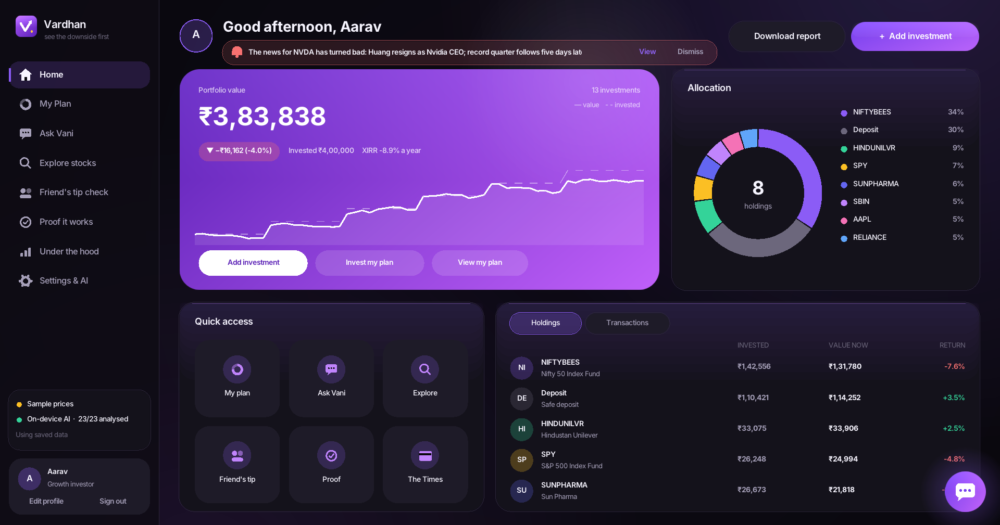
</p>

## 02 &nbsp; The screens

| Screen | What it does |
|---|---|
| **Home** | Portfolio value, how much you invested, profit or loss, XIRR, value-over-time chart, allocation, holdings and transactions |
| **My Plan** | Every stock gets a 0 to 100 fit score; 3,000 simulated years drawn as a fan chart; goal odds like *72% chance of ₹6L in 3 years* |
| **Ask Vani** | The AI money guide. Instant answers from the engine first, then an explanation grounded in your plan and the news. Also a chat bubble on every page |
| **Explore stocks** | 23 real Indian and US stocks: price history, the AI's reading of the news, a *what if I invest* simulator, price and news alerts |
| **Friend's tip check** | *Risky for you right now*, with reasons, the chance you lose money, and better fits |
| **The Vardhan Times** | Ask *why?* and the AI's reading opens as a broadsheet page: headline, columns, a halftone chart, before-and-after risk numbers |
| **Proof it works** | Rebuilds the plan from prices one year old and replays it against what really happened, plus a check of how honest the "bad month" warnings were |
| **Under the hood** | Each data structure working live, including an animated correlation graph |

Also: a one-click demo account, PIN-protected local accounts, a 4-page PDF report (the PDF writer is hand-written), three themes and sounds generated from maths at start-up.

<details>
<summary><b>See more screens</b></summary>
<br>

| | |
|:-:|:-:|
| 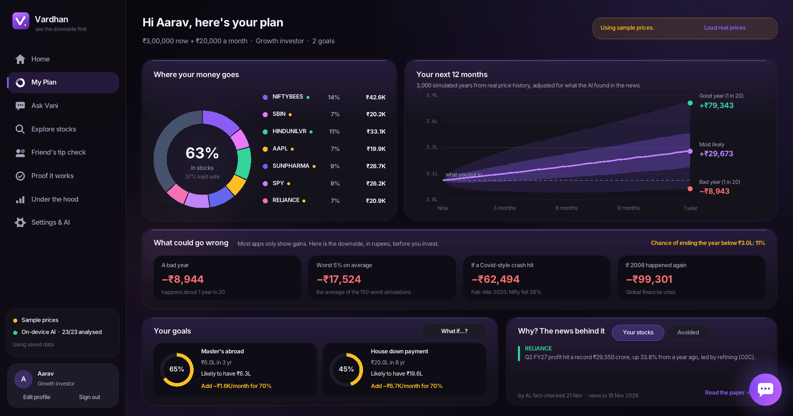 | 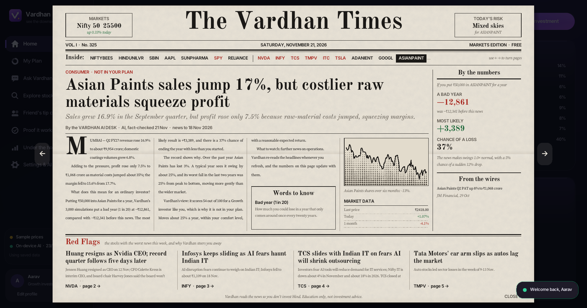 |
| **My Plan** | **The Vardhan Times** |
| 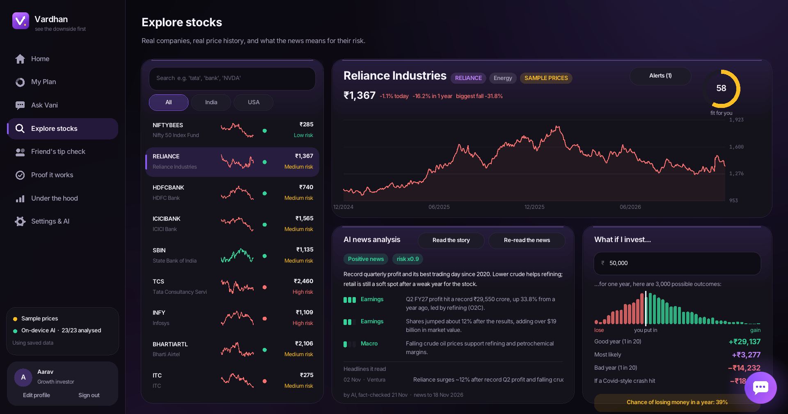 | 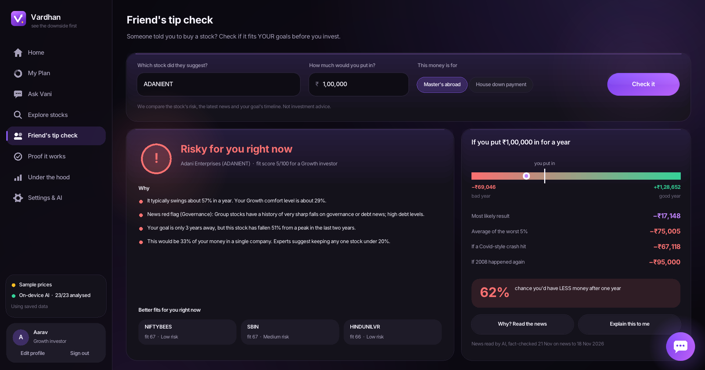 |
| **Explore stocks** | **Friend's tip check** |
| 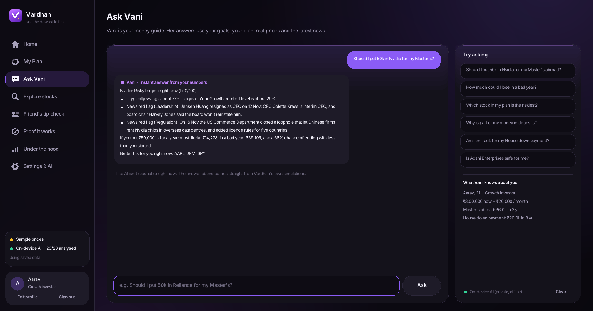 | 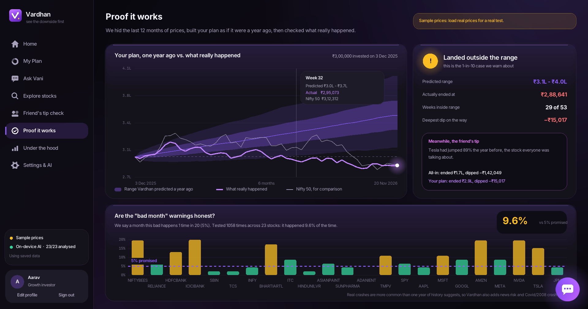 |
| **Ask Vani** | **Proof it works** |
| 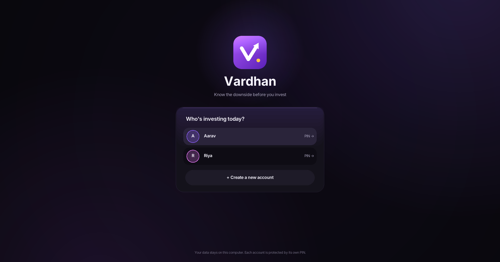 | 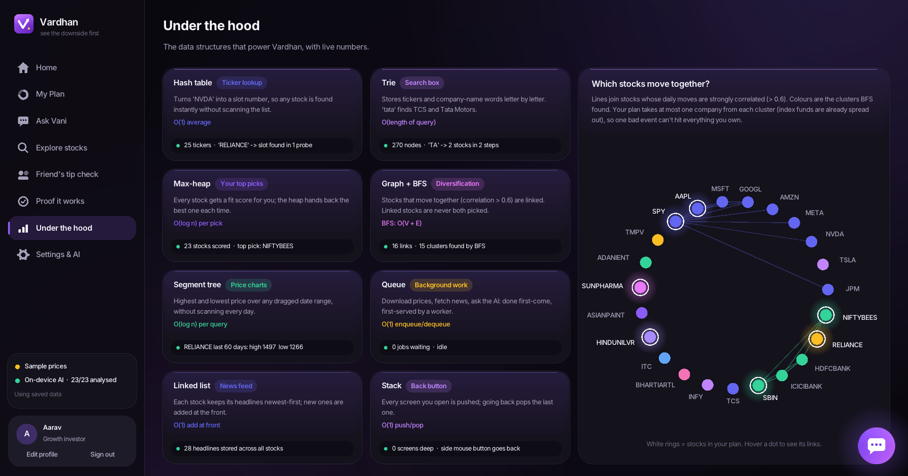 |
| **Sign in** | **Under the hood** |

</details>

## 03 &nbsp; How it's built

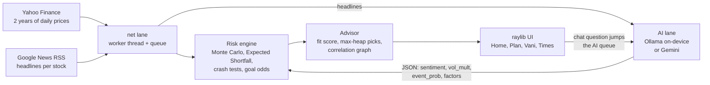

## 04 &nbsp; Decisions I'd defend in an interview

- **The AI never predicts a price.** It reads headlines and returns bounded JSON (`sentiment`, `vol_mult`, `drift_tilt`, `event_prob`, `event_size`). The simulation uses those numbers, clamped to safe ranges, so a bad AI answer can't produce absurd results. Every rupee on screen comes from code that is tested.
- **Two worker lanes, not one.** The first version had one queue, and price downloads waited behind 23 AI analyses: a chat reply took 500 seconds. Now network and AI run on separate threads, a chat question is pushed to the *front* of the AI deque and interrupts a background analysis, and the answer streams in word by word.
- **On-device AI by default.** Ollama runs a 3B model locally, so financial data never leaves the laptop, there is no key and no usage limit. If it's closed, the last fact-checked analysis is shown with its date.
- **Show the miss, don't hide it.** *Proof it works* reports how often a "1-in-20 bad month" really happened across 1,000+ tests, even when the answer is worse than promised.
- **Diversification is a graph problem.** Stocks with daily-return correlation above 0.6 are linked; picks come off a max-heap but skip anything already in the same BFS cluster.

<details>
<summary><b>Read the simulation loop</b></summary>
<br>

```c
/* src/risk.c: the AI's reading changes the numbers, clamped so it can't go wild */
static float adj_drift(const Stock *s) { return s->mu + (s->ai.valid ? s->ai.drift_tilt : 0); }
static float adj_volm(const Stock *s) { float v = s->ai.valid ? s->ai.vol_mult : 1; return v < 0.5f ? 0.5f : v > 2.5f ? 2.5f : v; }

for (int p = 0; p < NSIM; p++) {                     /* 3,000 simulated years   */
    float lr = 0;
    for (int d = 0; d < days; d += 5) {
        int k = (int)(runit() * (n - 5));            /* re-sample a real week   */
        for (int j = 0; j < 5 && d + j < days; j++) lr += mu + vm * r[k + j];
    }
    if (runit() < ep) lr += logf(1 + es);            /* news-driven shock       */
    fin[p] = amount * expf(lr);
}
```
</details>

## 05 &nbsp; Data structures

| Structure | Where it's used | Why |
|---|---|---|
| **Hash table** | ticker → stock, account names | O(1) lookup |
| **Trie** | search box and friend-tip autocomplete | "tata" finds TCS and Tata Motors in O(length of query) |
| **Max-heap** | top picks by fit, safer alternatives, triggered alerts by urgency | O(log n) per pick |
| **Graph + BFS** | correlation links and clusters | keeps the plan diversified |
| **Segment tree** | high and low over any dragged date range on a chart | O(log n) range query |
| **Queue / deque** | background jobs, with chat pushed to the front | the UI never freezes |
| **Linked list** | each stock's news feed, the transaction history | O(1) insert at the front |
| **Stack** | screen navigation history | O(1) back |

Plus binary search to price a backdated investment from history, and Newton's method for XIRR.

## 06 &nbsp; Details I obsessed over

- **Rupees, not percentages.** *In a bad year you could lose ₹31,000* lands; *VaR 95% = −8.2%* doesn't.
- **A newspaper that reads like one.** Justified, balanced columns with a drop cap, a halftone chart, Red Flags briefs, and a different headline for every company.
- **Fact-checked news.** The 23 bundled analyses were checked against published reports on 21 Nov 2026, and the wrong claims were corrected or removed.
- **It scales with the window.** Fonts are re-rasterised at the current zoom, and Ctrl + / Ctrl − change text size.
- **PINs are never stored.** Only a salted hash, stretched over 20,000 rounds, with a lock-out after five wrong tries.

## 07 &nbsp; Run it

**Just try it (Windows):** download [Vardhan.zip](https://github.com/Stanvi09/Vardhan/raw/main/site/download/Vardhan.zip) (3 MB), unzip, double-click **Vardhan.exe**, then **Try the demo**. If Windows warns you, click *More info → Run anyway*.

**Build it on Windows:** install [w64devkit](https://github.com/skeeto/w64devkit/releases) and add its `bin` folder to `PATH` (raylib is bundled), then:

```bat
git clone https://github.com/Stanvi09/Vardhan.git
cd Vardhan
build.bat
```

**Linux:** `sudo apt install build-essential libx11-dev libgl1-mesa-dev`, then `make && ./vardhan`. **macOS:** `brew install raylib`, then `make`.

**Tests:** `make test` gives **63 passed**.

**On-device AI (optional, about 5 minutes):** install [Ollama](https://ollama.com), run `ollama pull llama3.2:3b`, then in Vardhan open **Settings & AI → On-device AI → Test connection**. Without it, Vardhan uses the bundled, fact-checked analyses.

## 08 &nbsp; Repository map

```
Vardhan/
├── src/
│   ├── ds.c            hash table, trie, heap, graph, segment tree, queue, list, stack
│   ├── risk.c          Monte Carlo, Expected Shortfall, crash tests, goal odds
│   ├── advisor.c       fit score, heap + graph picking, friend's tip check
│   ├── net.c           Yahoo prices, Google News, Ollama / Gemini, two worker lanes
│   ├── portfolio.c     transactions, binary-search pricing, XIRR
│   ├── report.c        a PDF writer, by hand
│   ├── paper.c         The Vardhan Times
│   ├── scr_*.c         one file per screen
│   └── tests.c         63 tests
├── include/            ds.h, model.h, net.h, ui.h, app.h
├── data/analysis/      23 fact-checked AI readings, plain text
├── assets/             fonts (SIL OFL), logo, Windows icon
├── third_party/        raylib 5.5 (zlib), cJSON (MIT)
├── docs/               screenshots, a sample PDF report, presentation notes
├── site/               the landing page and the Windows download
└── Makefile · build.bat · render.yaml
```

## 09 &nbsp; Honest limits

- Simulations re-sample the last two years. Real crises can be worse than anything in that window, which is why crash tests are shown separately.
- AI readings of headlines can be wrong, so the app shows which headlines were read and when.
- It's an education tool, **not investment advice**. In India, personalised advice needs SEBI registration.

## 10 &nbsp; Next

- Mutual funds and ETFs, and tax-aware goals (LTCG)
- Fat-tailed shocks in the simulation
- Link a broker API instead of entering investments by hand
- A web version, so it runs without a download

<br>

<picture>
  <source media="(prefers-color-scheme: dark)" srcset=".github/assets/footer-dark.svg">
  
</picture>

<p align="center"><sub><a href="https://www.linkedin.com/in/tanvi-sadashiv-3713ba381">LinkedIn</a> &nbsp;&middot;&nbsp; <a href="https://github.com/Stanvi09">GitHub</a></sub></p>
